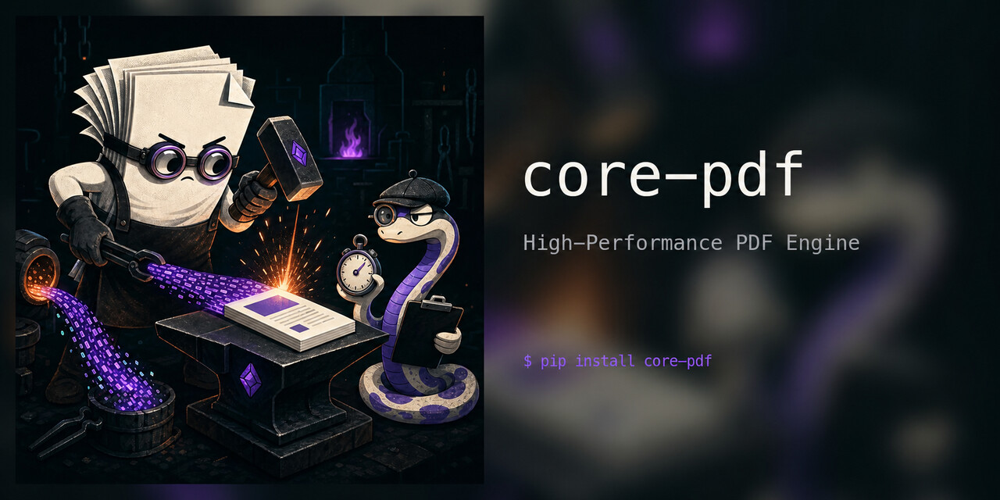

# core-pdf

High-Performance PDF Engine

> [!TIP]
> If you want to extract content from PDFs, use
> [`core-pdf-compat`](packages/core-pdf-compat/README.md). It exposes the engine through
> the pdfminer, pdfplumber, pypdf, unstructured, llamaindex, and x-ray interfaces.

## Packages

| Package | Purpose |
| ------- | ------- |
| `core-pdf` | Document API, extraction, rendering, CLI; also the strict PDF algorithms (`core_pdf.impl.spec`), JBIG2, the PostScript calculator, ciphers and PDF MAC, and Adobe font formats with CMaps |
| [`core-pdf-compat`](packages/core-pdf-compat/README.md) | Facades for third-party PDF library interfaces |
| [`core-pdf-ocr`](packages/core-pdf-ocr/README.md) | OCR for scanned and hybrid documents |
| [`core-pdf-validate`](packages/core-pdf-validate/README.md) | PDF/A, PDF/UA, and WTPDF validation through a local veraPDF |
| [`core-pdf-cythonized`](packages/core-pdf-cythonized/README.md) | Compiled kernels for core's hot paths |
| [`core-records`](packages/core-records/README.md) | Shared value-class mixins |

## Development

See [AGENTS.md](AGENTS.md) for build, test, and lint commands. Further reading:
the [API guide](docs/api.md), [standards and validation](docs/standards.md),
and the [roadmap](docs/roadmap.md).

## License

core-pdf uses [Core License version 0.1.0](https://github.com/warpforgedotco/core-pdf/blob/main/docs/license/VERSION.md).

Unless a separate signed evaluation license, commercial license, or philanthropy waiver applies, core-pdf is licensed under the GNU Affero General Public License version 3 only. See [LICENSE.txt](LICENSE.txt).

Evaluation licenses, commercial licenses, and philanthropy waivers are available separately. See the [license documentation](https://github.com/warpforgedotco/core-pdf/blob/main/docs/license/README.md), [notice](https://github.com/warpforgedotco/core-pdf/blob/main/docs/license/NOTICE), [evaluation terms](https://github.com/warpforgedotco/core-pdf/blob/main/docs/license/LICENSE-EVALUATION.txt), [commercial terms](https://github.com/warpforgedotco/core-pdf/blob/main/docs/license/LICENSE-COMMERCIAL.txt), and [philanthropy waiver terms](https://github.com/warpforgedotco/core-pdf/blob/main/docs/license/LICENSE-PHILANTHROPY-WAIVER.txt). Those alternatives are effective only when signed by the project licensor.

Contact: <turcioskevinr@gmail.com>
